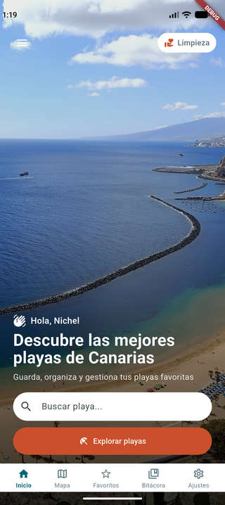
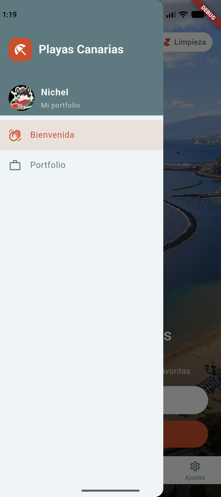
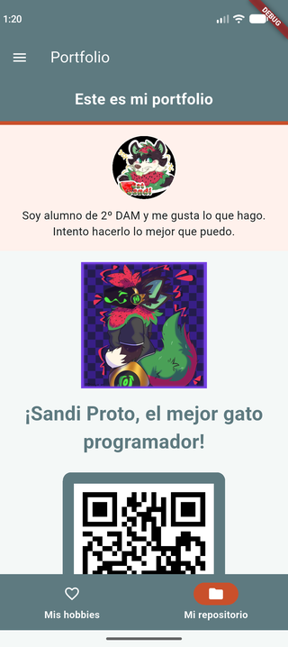
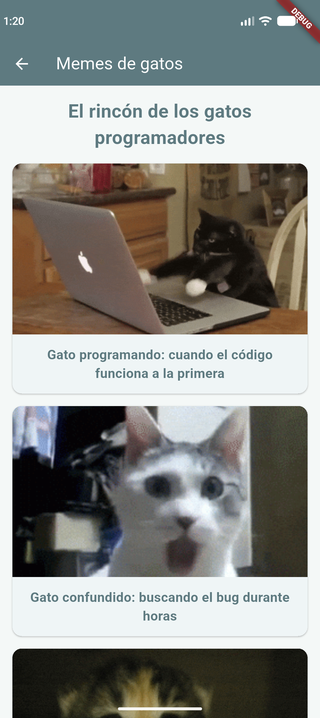

# Playas Canarias - My Portfolio

Flutter application developed for the **Programación Multimedia y Dispositivos Móviles (PGL)** course. Personal portfolio app with sidebar navigation (Drawer) and route management using `go_router`.

## Features

- **Sidebar navigation (Drawer)** - Navigate between the different screens of the application
- **Welcome screen** - Main screen with background image, personalized greeting, search bar and bottom navigation bar
- **Portfolio screen** - Personal section with student info, interactive hobbies grid and GitHub repository
- **Interactive hobbies** - Grid with 8 different hobbies; tapping "Los gatos" opens a cat memes gallery
- **Cat memes gallery** - Secondary screen with programmer cat gifs loaded from Giphy
- **QR code** - Generated with `qr_flutter` linking to the GitHub profile
- **GoRouter navigation** - Centralized routes (`/bienvenida` and `/portfolio`)

## Tech stack

- [Flutter](https://flutter.dev/) - SDK ^3.13.5
- [Material Design 3](https://m3.material.io/)
- [go_router](https://pub.dev/packages/go_router) ^16.2.1 - Declarative navigation
- [qr_flutter](https://pub.dev/packages/qr_flutter) ^4.1.0 - QR code generation

## Project structure

```text
lib/
├── main.dart                # App entry point and global configuration
├── router/
│   └── app_router.dart      # Route configuration with go_router
├── widgets/
│   └── app_drawer.dart      # Sidebar navigation drawer
└── pages/
    ├── welcome_page.dart     # Welcome screen
    └── portfolio_page.dart   # Portfolio screen (profile, hobbies, repository, memes)
```

## Resources

### Local images

- `lib/images/home_bg.jpg` - Background image for the welcome screen
- `assets/images/Sandi_proto.jpg` - Sandi Proto image in the repository section

### Data sources

- Avatar loaded from `https://github.com/Catsandi06.png`
- QR code points to `https://github.com/Catsandi06/`
- Memes loaded from [Giphy](https://giphy.com/)

## Screens

### Welcome screen

Main screen with beach background, hamburger menu to open the drawer, "Limpieza" card, greeting, beach search bar and bottom navigation bar.

### Sidebar (Drawer)

Shows user information (Nichel Morales Hernández - USR3742), GitHub avatar and app icon. Allows navigation between "Bienvenida" and "Portfolio".

### Portfolio screen

- **Header**: "Portfolio" title
- **Profile**: Avatar and student description
- **Tabs**: "Mis hobbies" and "Mi repositorio" with `NavigationBar`
- **Hobbies**: Grid with 8 different hobbies (Informática, Música, Gatos, Consolas retro, Furry, Coches, Impresión 3D, Viajes)
- **Repository**: Sandi Proto image, description and QR code to GitHub
- **Cat memes**: Secondary screen accessible from the "Los gatos" hobby

## Screenshots

### Android

<p align="center">
  
  
  
  
  
</p>

| Screen | Description |
| --- | --- |
| Welcome | Main screen with beach background image |
| Drawer open | Sidebar with user information |
| Portfolio - My hobbies | Portfolio hobbies tab |
| Portfolio - My repository | Repository tab with GitHub QR code |
| Cat memes | Programmer cat memes screen (accessible from "Los gatos" hobby) |

## Installation and running

### Prerequisites

- [Flutter SDK](https://docs.flutter.dev/get-started/install) ^3.13.5
- Android Studio / VS Code
- Android emulator or physical device

### Steps

1. **Clone the repository**
```bash
git clone https://github.com/Catsandi06/PGL-P2-MyPortfolio.git
cd PGL-P2-MyPortfolio
```

2. **Install dependencies**
```bash
flutter pub get
```

3. **Run the application**
```bash
# On connected emulator/device
flutter run

# Or select a specific device
flutter run -d <device_id>
```

## Author

**Nichel Morales Hernández** (USR3742)  
[GitHub](https://github.com/Catsandi06)

## License

This project is for educational purposes only.