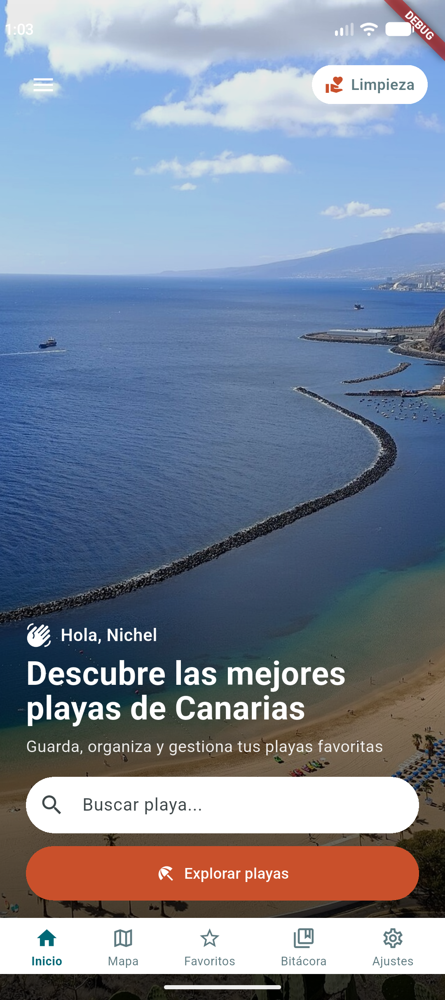
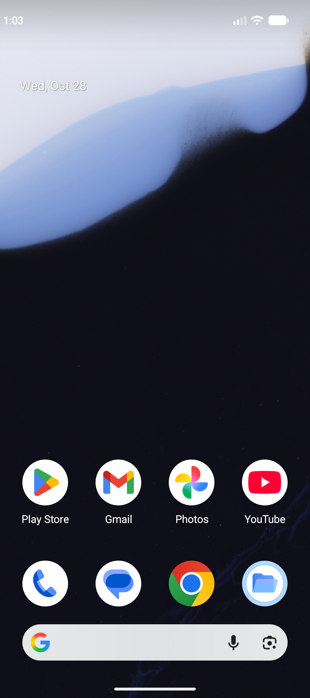
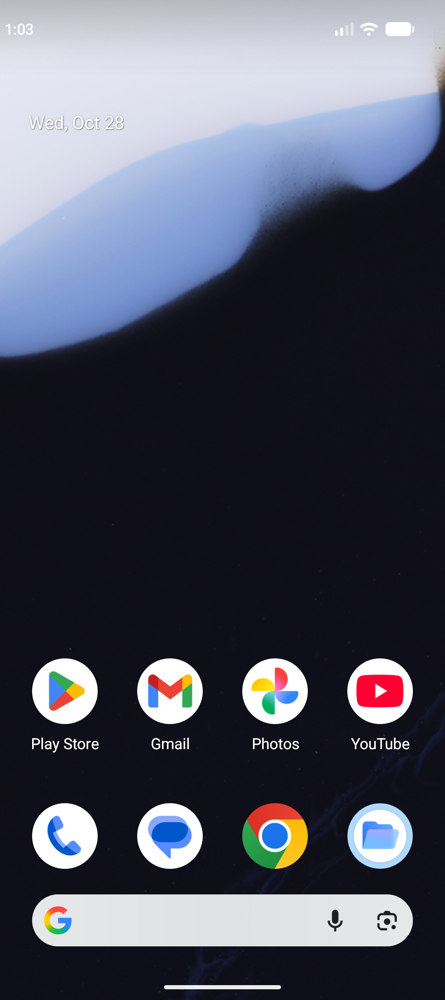

# Playas Canarias - My Portfolio

Aplicación Flutter desarrollada para la asignatura **Programación Multimedia y Dispositivos Móviles (PGL)**. Portfolio personal con navegación mediante menú lateral (Drawer) y gestión de rutas con `go_router`.

## Características

- **Menú lateral (Drawer)** - Navegación entre las distintas pantallas de la aplicación
- **Pantalla de Bienvenida** - Pantalla principal con imagen de fondo, saludo personalizado, buscador y barra de navegación inferior
- **Pantalla de Portfolio** - Sección personal con información del alumno, lista de hobbies interactivos y repositorio GitHub
- **Hobbies interactivos** - Grid con diferentes hobbies; al pulsar "Los gatos" accede a una galería de memes
- **Galería de memes** - Pantalla con gifs de gatos programadores cargados desde Giphy
- **Código QR** - Generado con `qr_flutter` que enlaza al perfil de GitHub
- **Navegación con GoRouter** - Rutas centralizadas (`/bienvenida` y `/portfolio`)

## Tecnologías utilizadas

- [Flutter](https://flutter.dev/) - SDK ^3.13.5
- [Material Design 3](https://m3.material.io/)
- [go_router](https://pub.dev/packages/go_router) ^16.2.1 - Navegación declarativa
- [qr_flutter](https://pub.dev/packages/qr_flutter) ^4.1.0 - Generación de códigos QR

## Estructura del proyecto

```text
lib/
├── main.dart           # Punto de entrada y configuración de la app
├── router/
│   └── app_router.dart # Configuración de rutas con go_router
├── widgets/
│   └── app_drawer.dart # Menú lateral de navegación
└── pages/
    ├── welcome_page.dart   # Pantalla de bienvenida
    └── portfolio_page.dart # Pantalla de portfolio (perfil, hobbies, repositorio y memes)
```

## Recursos

### Imágenes locales
- `lib/images/home_bg.jpg` - Imagen de fondo de la pantalla de bienvenida
- `assets/images/Sandi_proto.jpg` - Imagen de Sandi Proto en la sección de repositorio

### Datos
- Avatar cargado desde `https://github.com/Catsandi06.png`
- Código QR apunta a `https://github.com/Catsandi06/`
- Memes cargados desde [Giphy](https://giphy.com/)

## Pantallas

### Pantalla de Bienvenida
Pantalla principal con fondo de playa, menú hamburguesa para abrir el drawer, tarjeta "Limpieza", saludo, buscador de playas y barra de navegación inferior.

### Menú Lateral (Drawer)
Muestra información del usuario (Nichel Morales Hernández - USR3742), avatar de GitHub e icono de la app. Permite navegar entre "Bienvenida" y "Portfolio".

### Pantalla de Portfolio
- **Cabecera**: Título "Portfolio"
- **Perfil**: Avatar y descripción del alumno
- **Pestañas**: "Mis hobbies" y "Mi repositorio" con `NavigationBar`
- **Hobbies**: Grid con 8 hobbies diferentes (Informática, Música, Gatos, Consolas retro, Furry, Coches, Impresión 3D, Viajes)
- **Repositorio**: Imagen de Sandi Proto, descripción y código QR hacia GitHub
- **Memes de gatos**: Pantalla secundaria accesible desde el hobby "Los gatos"

## Capturas de pantalla

### Android

|                                     Pantalla                                     | Descripción                                |
|:--------------------------------------------------------------------------------:|--------------------------------------------|
|                      | Pantalla de bienvenida con imagen de fondo |
|                                  | Menú lateral con información del usuario   |
|              | Pestaña de hobbies del portfolio           |
|  | Interacción con el hobby "Los gatos"       |
|       | Pestaña de repositorio con QR de GitHub    |
|                             | Pantalla de memes de gatos programadores   |

## Instalación y ejecución

### Requisitos previos
- [Flutter SDK](https://docs.flutter.dev/get-started/install) ^3.13.5
- Android Studio / VS Code
- Emulador Android o dispositivo físico

### Pasos

1. **Clonar el repositorio**
```bash
git clone https://github.com/Catsandi06/PGL-P2-MyPortfolio.git
cd PGL-P2-MyPortfolio
```

2. **Instalar dependencias**
```bash
flutter pub get
```

3. **Ejecutar la aplicación**
```bash
# En emulador/dispositivo conectado
flutter run

# O seleccionar dispositivo específico
flutter run -d <device_id>
```

## Autor

**Nichel Morales Hernández** (USR3742)  
[GitHub](https://github.com/Catsandi06)

## Licencia

Este proyecto es únicamente con fines educativos.
