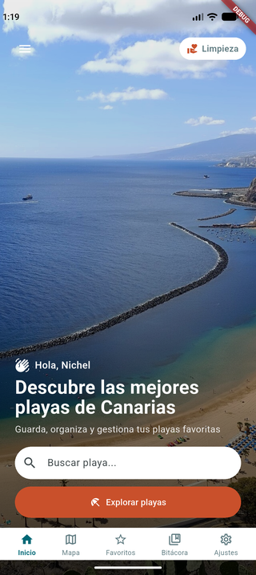
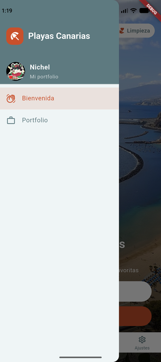
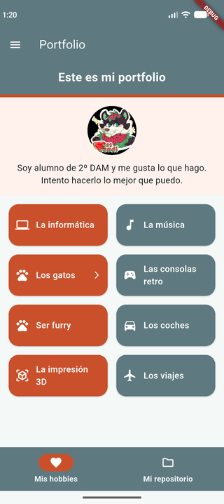
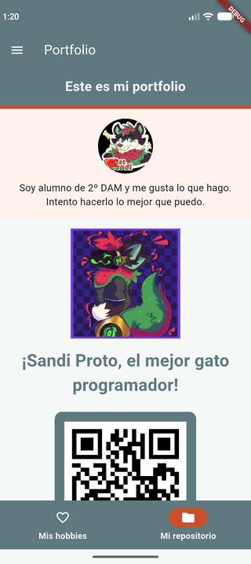
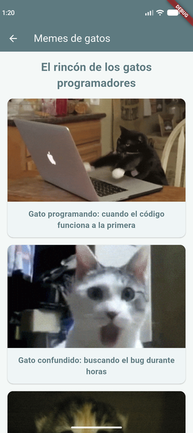
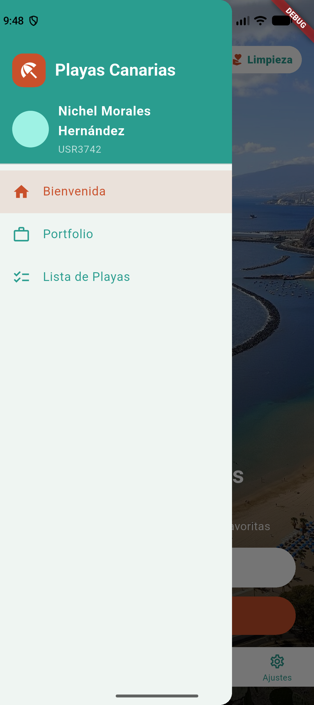
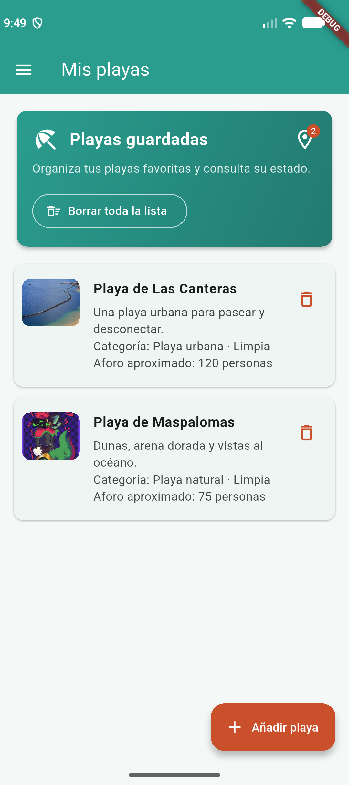
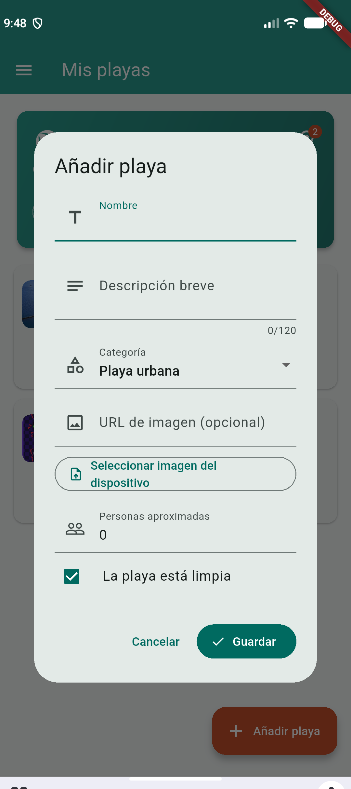
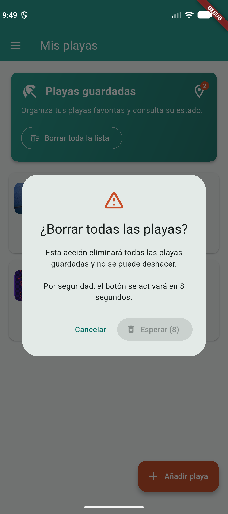

# Playas Canarias - My Portfolio

Aplicación Flutter desarrollada para la asignatura **Programación Multimedia y Dispositivos Móviles (PGL)**. Incluye un portfolio personal y un CRUD local para gestionar playas, con navegación mediante menú lateral (`Drawer`) y rutas declarativas con `go_router`.

## Características

- **Menú lateral (Drawer)** - Navegación entre las distintas pantallas de la aplicación
- **Pantalla de Bienvenida** - Pantalla principal con imagen de fondo, saludo personalizado, buscador visual y barra de navegación inferior
- **Pantalla de Portfolio** - Sección personal con información del alumno, lista de hobbies interactivos y repositorio GitHub
- **Hobbies interactivos** - Grid con 8 hobbies diferentes; al pulsar "Los gatos" accede a una galería de memes
- **Galería de memes** - Pantalla con gifs de gatos programadores cargados desde Giphy
- **Código QR** - Generado con `qr_flutter` que enlaza al perfil de GitHub
- **CRUD de playas** - Lista dinámica con alta desde un `Dialog`, imagen por URL o galería, categoría, limpieza, aforo aproximado, borrado individual, borrado total protegido y contador
- **Navegación con GoRouter** - Rutas centralizadas (`/bienvenida`, `/portfolio` y `/crud_playas`)

## Tecnologías utilizadas

- [Flutter](https://flutter.dev/) - Aplicación probada con Flutter 3.47.9
- [Dart](https://dart.dev/) - SDK `^3.13.5`
- [Material Design 3](https://m3.material.io/)
- [go_router](https://pub.dev/packages/go_router) ^18.1.2 - Navegación declarativa
- [qr_flutter](https://pub.dev/packages/qr_flutter) ^4.1.0 - Generación de códigos QR
- [image_picker](https://pub.dev/packages/image_picker) ^1.2.4 - Selección segura de imágenes
- [flutter_launcher_icons](https://pub.dev/packages/flutter_launcher_icons) ^0.14.4 - Generación del icono de la aplicación

## Estructura del proyecto

```text
lib/
├── main.dart                # Punto de entrada y configuración de la app
├── router/
│   └── app_router.dart      # Configuración de rutas con go_router
├── widgets/
│   └── app_drawer.dart      # Menú lateral de navegación
└── pages/
    ├── welcome_page.dart     # Pantalla de bienvenida
    ├── portfolio_page.dart   # Pantalla de portfolio (perfil, hobbies, repositorio y memes)
    └── crud_playas_page.dart # CRUD de playas y formulario modal
```

## Recursos

### Imágenes locales

- `assets/images/home_bg.jpg` - Imagen de fondo de la pantalla de bienvenida
- `assets/images/Sandi_proto.jpg` - Imagen de Sandi Proto en la sección de repositorio

### Datos

- Avatar cargado desde `https://github.com/Catsandi06.png`
- Código QR apunta a `https://github.com/Catsandi06/`
- Memes cargados desde [Giphy](https://giphy.com/)

## Pantallas

### Pantalla de Bienvenida

Pantalla principal con fondo de playa, menú hamburguesa para abrir el drawer, tarjeta "Limpieza", saludo, buscador de playas y barra de navegación inferior.

### Menú Lateral (Drawer)

Muestra información del usuario (Nichel Morales Hernández - USR3742), avatar de GitHub e icono de la app. Permite navegar entre "Bienvenida", "Portfolio" y "Lista de Playas".

### Pantalla de Lista de Playas

La opción **Lista de Playas** del Drawer abre la ruta `/crud_playas` y muestra
una lista dinámica construida con `ListView.builder`. El botón **Añadir playa**
abre un `showDialog` con un `Form` que valida nombre, descripción breve,
categoría, imagen, limpieza y aforo aproximado.

Las imágenes pueden introducirse de dos formas:

1. **URL remota**: debe usar `https://`.
2. **Galería del dispositivo**: `image_picker` devuelve un `XFile`, que se lee
   en memoria como bytes.

Las imágenes locales tienen un límite de 10 MB y se comprueba su firma binaria
para aceptar únicamente JPEG, PNG o WebP. No se ejecutan archivos, no se usan
sus rutas para acceder al sistema y no se confía solo en la extensión o en el
MIME declarado por el dispositivo. Si no se selecciona una imagen, se muestra
una imagen local de respaldo según la categoría.

## Explicación del CRUD paso a paso

### 1. Modelo de datos

`Beach` es una clase inmutable que representa una playa. Contiene:

| Propiedad           | Tipo         | Uso                                   |
|---------------------|--------------|---------------------------------------|
| `name`              | `String`     | Nombre de la playa                    |
| `description`       | `String`     | Descripción breve                     |
| `category`          | `String`     | Urbana, natural, familiar o deportiva |
| `imageUrl`          | `String`     | URL `https` opcional                  |
| `imageBytes`        | `Uint8List?` | Imagen local temporal en memoria      |
| `isClean`           | `bool`       | Estado del checkbox de limpieza       |
| `approximatePeople` | `int`        | Número aproximado de personas         |

### 2. Estado y lista dinámica

`CrudPlayasPage` es un `StatefulWidget` porque la lista cambia durante la
ejecución. `_beaches` guarda las playas actuales. Cuando se añade o elimina
una playa, `setState` notifica a Flutter y reconstruye únicamente la interfaz
necesaria. El `Badge` superior utiliza `_beaches.length`, por lo que el total
se actualiza automáticamente.

### 3. Alta mediante modal

`_showAddBeachDialog` abre `_AddBeachDialog` con `showDialog`. El formulario
mantiene sus propios controladores y valida los campos antes de guardar:

- Nombre y descripción no pueden estar vacíos.
- La URL, si existe, debe empezar por `https://`.
- El aforo debe ser un número entero igual o mayor que cero.
- La imagen local debe superar las comprobaciones de tamaño y formato.

Cuando todo es válido, `Navigator.pop` devuelve un objeto `Beach`. La pantalla
principal lo recibe y lo añade a `_beaches` mediante `setState`.

### 4. Imágenes

La tarjeta decide qué widget utilizar:

- `Image.memory` si existe `imageBytes`.
- `Image.network` si se indicó una URL.
- `Image.asset` como respaldo local.

Si una imagen remota falla, `errorBuilder` evita que se rompa la tarjeta y
muestra el respaldo local.

### 5. Borrado individual y total

El icono de papelera elimina una playa concreta por su índice y muestra un
`SnackBar` informativo. **Borrar toda la lista** primero abre un diálogo de
confirmación. Su botón permanece deshabilitado durante 10 segundos mediante un
`Timer`; al llegar a cero se habilita y solo entonces `clear()` vacía la lista.
El temporizador se cancela en `dispose` para no dejar tareas activas cuando el
diálogo se cierra.

### 6. Navegación

`lib/router/app_router.dart` declara `/crud_playas` y construye
`CrudPlayasPage`. `AppDrawer` contiene el elemento **Lista de Playas**, cierra
el menú y navega con `context.go`. Así todas las pantallas usan el mismo
sistema de navegación.

### 7. Datos y ciclo de vida

Las playas de ejemplo y las nuevas playas se mantienen en la lista `_beaches`
durante la ejecución de la aplicación. Actualmente no hay una base de datos ni
persistencia en disco: al cerrar o reiniciar la aplicación, la lista vuelve a
los datos iniciales definidos en `CrudPlayasPage`.

### 8. Icono de la aplicación

La imagen `assets/icon/logo_sandi.jpg` se configura con
`flutter_launcher_icons`. El comando:

```bash
dart run flutter_launcher_icons
```

Genera las distintas resoluciones Android y el conjunto `AppIcon` de iOS.
Después se debe reinstalar la aplicación en el dispositivo para que el sistema
muestre el nuevo icono.

### Pantalla de Portfolio

- **Cabecera**: Título "Portfolio"
- **Perfil**: Avatar y descripción del alumno
- **Pestañas**: "Mis hobbies" y "Mi repositorio" con `NavigationBar`
- **Hobbies**: Grid con 8 hobbies diferentes (Informática, Música, Gatos, Consolas retro, Furry, Coches, Impresión 3D, Viajes)
- **Repositorio**: Imagen de Sandi Proto, descripción y código QR hacia GitHub
- **Memes de gatos**: Pantalla secundaria accesible desde el hobby "Los gatos"

## Capturas de pantalla

### Android

<div style="margin: 5px">
  
  
  
  
  
  
  
  
  
</div>

| Pantalla                   | Descripción                                                                     |
|----------------------------|---------------------------------------------------------------------------------|
| Bienvenida                 | Pantalla principal con imagen de fondo de playa                                 |
| Drawer abierto             | Menú lateral con información del usuario                                        |
| Portfolio - Mis hobbies    | Pestaña de hobbies del portfolio                                                |
| Portfolio - Mi repositorio | Pestaña de repositorio con QR de GitHub                                         |
| Memes de gatos             | Pantalla de memes de gatos programadores (accesible desde el hobby "Los gatos") |
| Drawer - Lista de Playas   | Acceso del menú lateral al CRUD de playas                                       |
| Lista de playas            | Contador, tarjetas, categorías, limpieza, aforo y borrado individual            |
| Añadir playa               | Modal con formulario, selector de categoría, imagen, aforo y limpieza           |
| Borrar toda la lista       | Confirmación y cuenta atrás de seguridad antes de eliminar                      |

## Instalación y ejecución

### Requisitos previos

- [Flutter SDK](https://docs.flutter.dev/get-started/install) 3.47.9 o compatible
- Dart SDK `^3.13.5`
- Android Studio / VS Code
- Emulador Android o dispositivo físico

### Pasos

1. **Clonar el repositorio**
```bash
git clone https://github.com/Catsandi06/PGL-P2-MyPortfolio.git
cd PGL-P2-MyPortfolio
```

2. **Instalar dependencias**
```bash
flutter pub get
```

3. **Ejecutar la aplicación**
```bash
# En emulador/dispositivo conectado
flutter run

# O seleccionar dispositivo específico
flutter run -d <device_id>
```

### Comprobaciones

```bash
flutter analyze
flutter test
```

El proyecto se ha validado con el análisis estático y las pruebas de widgets
incluidas en `test/widget_test.dart`.

## Autor

**Nichel Morales Hernández** (USR3742)  
[GitHub](https://github.com/Catsandi06)

## Licencia

Este proyecto es únicamente con fines educativos.